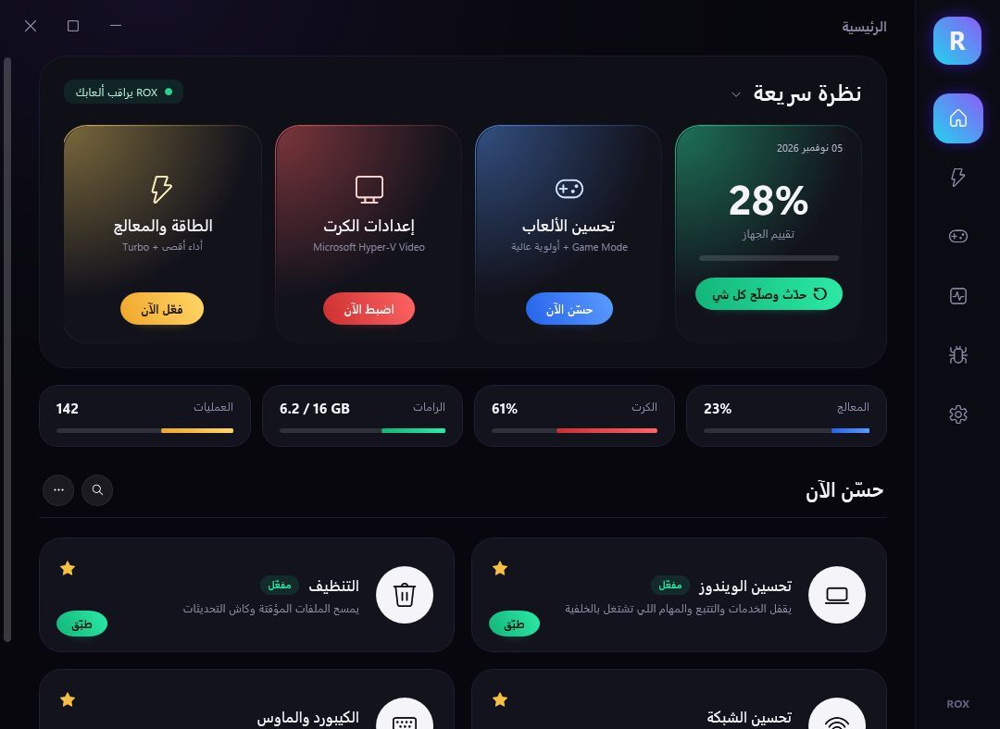
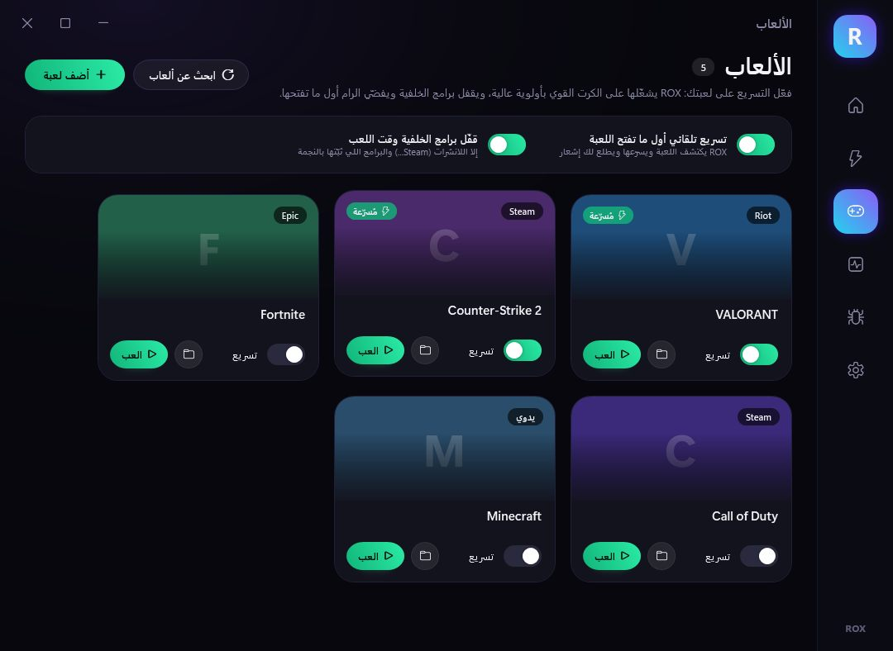
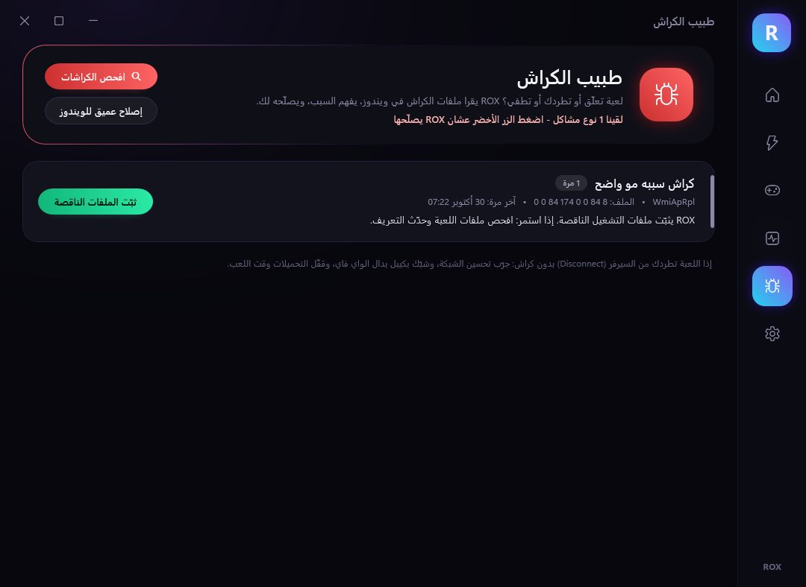
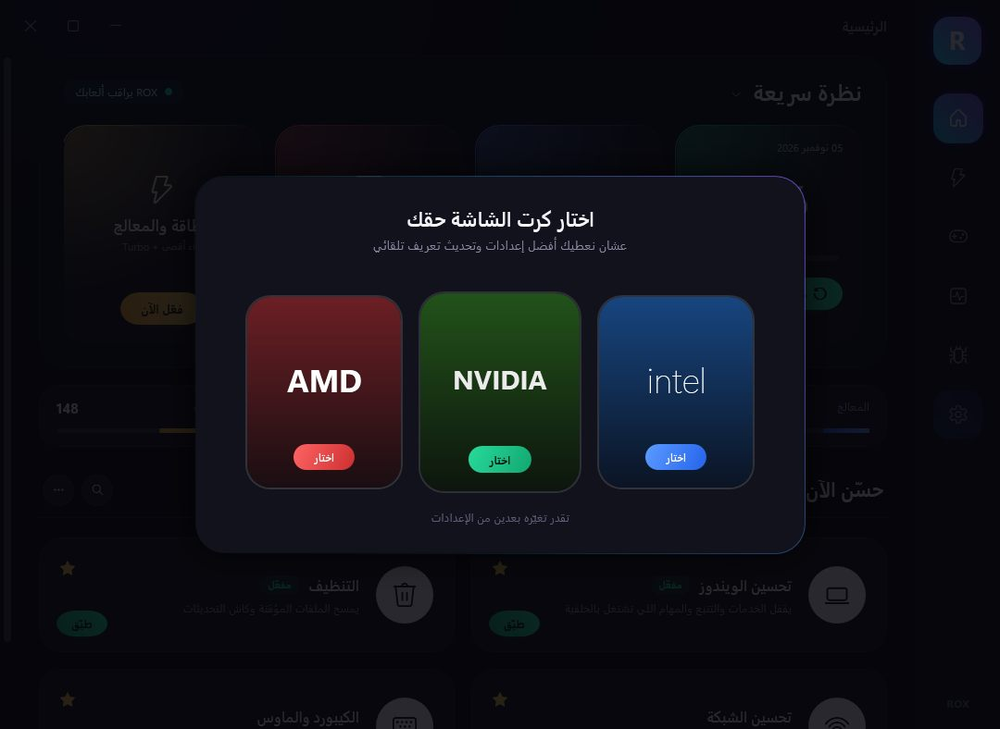

# ROX 🎮 – برنامج تسريع الألعاب لويندوز 10 و 11

برنامج بواجهة عربية وتصميم داكن متحرك. يزيد ثبات الفريمات، يقلل اللاق، ويقفل برامج الخلفية اللي تاكل الرامات. يسرّع لعبتك تلقائياً أول ما تفتحها، ويقرأ ملفات الكراش ويصلّح سببها.

كل تغيير يسويه ROX **ينحفظ**، وتقدر ترجّع كل شي مثل ما كان من **الإعدادات ← رجّع كل شي**.

| الألعاب | طبيب الكراش | اختيار الكرت |
|---|---|---|
|  |  |  |

> الصور من تشغيل حقيقي على ويندوز. بعض الألعاب فيها للعرض بس.

---

## التشغيل

1. نزّل **`ROX.zip`** وسوّ له **Extract All / فك الضغط** (لا تشغّله من داخل الـ ZIP).
2. دبل كليك على **`ROX.bat`** واضغط **نعم** لما يطلب صلاحيات المسؤول.
   - إذا طلع "Windows protected your PC": اضغط **More info** ثم **Run anyway**.
3. أول مرة بيسألك عن **كرت الشاشة** (AMD / NVIDIA / Intel)، ومعلّم لك الكرت اللي اكتشفه في جهازك.
4. اضغط الزر الأخضر **«حدّث وصلّح كل شي»** وبعدها سوّ **ريستارت**.

بعد أول تشغيل بيطلع لك اختصار **ROX** على سطح المكتب.

---

## الأقسام

| القسم | وش فيه |
|---|---|
| 🏠 **الرئيسية** | تقييم جهازك (%)، المعالج والكرت والرام وعدد العمليات مباشرة، وأزرار سريعة: تحسين الألعاب / إعدادات الكرت / الطاقة، و**الزر الأخضر: حدّث وصلّح كل شي** |
| ⚡ **التحسينات** | 9 تحسينات تقدر تطبّقها وحدة وحدة أو كلها مرة وحدة، والنجمة تثبّت التحسين في الرئيسية |
| 🎮 **الألعاب** | يلقى ألعابك من **Steam و Epic و Riot** تلقائياً، وتقدر تضيف أي لعبة يدوياً. فعّل **تسريع** على اللعبة واضغط **العب** |
| 🧹 **برامج الخلفية** | كل البرامج المفتوحة مرتبة حسب الرام. قفّل المحدد، أو **قفّل كل الخلفية**، أو **فضّي الرام** |
| 🩺 **طبيب الكراش** | يقرأ ملفات الكراش في ويندوز، يقولك **ليش** اللعبة طاحت أو علّقت، ويعطيك زر **يصلّحها** |
| ⚙️ **الإعدادات** | تغيير الكرت، التسريع التلقائي، التشغيل مع الويندوز، Memory Integrity، و**رجّع كل شي** |

---

## الزر الأخضر: «حدّث وصلّح كل شي»

1. يسوي **نقطة استعادة** (System Restore) للأمان.
2. يطبّق **كل التحسينات**: الويندوز، الألعاب، الكرت، الطاقة، الشبكة، الكيبورد والماوس، برامج بدء التشغيل، الرامات، والتنظيف.
3. يحدّث **تعريف الكرت**:
   - NVIDIA ← يثبّت NVIDIA app.
   - Intel ← يثبّت Intel Driver & Support Assistant.
   - AMD ← يفتح صفحة AMD الرسمية.
   - وكمان يسمح لـ Windows Update ينزّل التعريفات من نفسه.
4. يثبّت ويصلّح **ملفات تشغيل الألعاب**: Visual C++ و DirectX و .NET.
5. يحدّث **برامجك** عن طريق winget.
6. يصلّح **مشاكل الكراش** اللي يقدر يصلّحها تلقائي: الذاكرة الافتراضية، ومهلة الكرت (TDR).
7. **الإصلاح العميق** (DISM + SFC): يصلّح ملفات ويندوز الخربانة. ياخذ 10 إلى 30 دقيقة، وتقدر تتخطاه.

---

## تسريع الألعاب التلقائي 🚀

فعّل **تسريع** على اللعبة من قسم الألعاب، وأول ما تفتحها ROX يسوي هذا تلقائياً:
- **يقفل برامج الخلفية**، ما عدا هذي ما يقفلها:
  - اللانشرات (Steam و Epic...).
  - برامج التواصل (Discord...).
  - المتصفح عشان ما تضيع التابات.
  - برامج البث والفريمات (OBS و MSI Afterburner).
  - البرامج اللي عليها نجمة.
- **يفضّي الرام** ويعطي اللعبة **أولوية معالج عالية**.
- يشغّل اللعبة على **الكرت القوي** دايماً (مهم للابتوبات اللي فيها كرتين).
- يطلع لك إشعار صغير في الزاوية فيه كم برنامج قفل وكم ميغا رام فضّى.

> لازم يكون ROX شغّال: لما تقفل النافذة يروح **جنب الساعة** ويكمّل يراقب. فعّل **«شغّل ROX مع الويندوز»** من الإعدادات عشان يشتغل دايماً.

---

## طبيب الكراش 🩺

يقرأ سجلات ويندوز لآخر 14 يوم ويفهم السبب:

| المشكلة | السبب | الزر |
|---|---|---|
| كراش في تعريف NVIDIA / AMD / Intel | تعريف قديم أو خربان، Overclock، حرارة | **صلّح الكرت** (يحدّث التعريف + يرفع مهلة الكرت TDR) |
| الشاشة تسود وترجع (TDR) | الكرت وقف عن الاستجابة | **صلّح الكرت** |
| ملفات Visual C++ / DirectX ناقصة | ملفات تشغيل ناقصة أو خربانة | **ثبّت الملفات الناقصة** |
| الذاكرة خلصت | ملف الصفحات (Page file) مقفول أو صغير | **صلّح الذاكرة** |
| ملفات اللعبة خربانة | ملف ناقص أو خربان في اللعبة | **افحص ملفات اللعبة** (Steam) |
| اللعبة علّقت | الرام أو برامج الخلفية | **فضّي الرام** |
| شاشة زرقا | تعريف / رام / معالج | **صلّح ويندوز** أو **افحص الرام** |
| أخطاء هاردوير (WHEA) / الجهاز طفى | Overclock أو XMP مو ثابت، حرارة، باور، BIOS قديم | نصيحة (يحتاج تدخل منك) |
| Overlay / أنتي تشيت | Discord / Steam Overlay / MSI Afterburner، أو مشكلة في EasyAntiCheat / BattlEye | نصيحة + فحص ملفات اللعبة |

> **«تطردني من السيرفر» بدون كراش:** هذي غالباً مشكلة شبكة. طبّق **تحسين الشبكة**، وشبّك بكيبل بدال الواي فاي، وقفّل التحميلات وقت اللعب.

---

## ⚠️ صراحة: وش تتوقع؟

- **الفريمات:** ROX يشيل الأشياء اللي تسرق من أداء جهازك، فتحس بفرق في **الثبات وقلة التقطيع** (1% lows)، وزيادة الفريمات غالباً من 5% إلى 20%. **ما فيه برنامج يضاعف الفريمات.** اللي يضاعفها فعلاً هو Frame Generation:
  - **NVIDIA RTX 40 و 50:** فعّل **DLSS Frame Generation** داخل اللعبة، أو **Smooth Motion** من NVIDIA app.
  - **AMD RX 6000 وأحدث:** فعّل **AMD Fluid Motion Frames (AFMF)** من AMD Software.
  - **Intel Arc:** فعّل **XeSS Frame Generation** في الألعاب اللي تدعمه.
  - **أي كرت:** استخدم **FSR** داخل اللعبة، أو برنامج **Lossless Scaling** من Steam.
- **الرامات:** ويندوز لحاله يحتاج تقريباً 1.5 إلى 2.5 جيجا. اللعبة نفسها تاخذ من 4 إلى 10 جيجا وهذا طبيعي، والهدف إن الرامات تروح **للعبة** مو لبرامج الخلفية.
- **Edge** بيكتب "managed by your organization"، وهذا بسبب إعداد يمنعه يشتغل بالخلفية. يروح لما ترجّع كل شي.
- **بحث ويندوز** عن الملفات بيصير أبطأ شوي. البحث عن البرامج والإعدادات يشتغل عادي.

---

## الملفات

| الملف | وش هو |
|---|---|
| `ROX.bat` | دبل كليك عليه عشان تشغّل البرنامج |
| `ROX.ps1` | واجهة البرنامج |
| `ROX.xaml` | تصميم الواجهة |
| `RoxEngine.ps1` | المحرك اللي يطبّق التحسينات ويرجّعها |

البيانات والنسخة الاحتياطية والسجل كلها في: `C:\ProgramData\ROX\`
