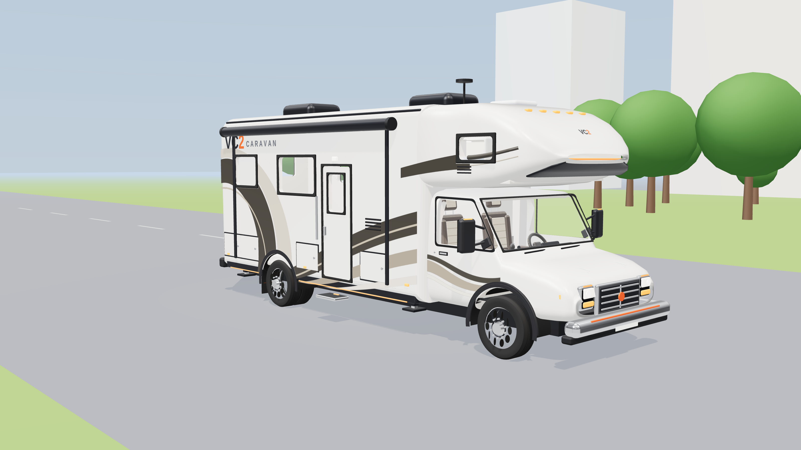
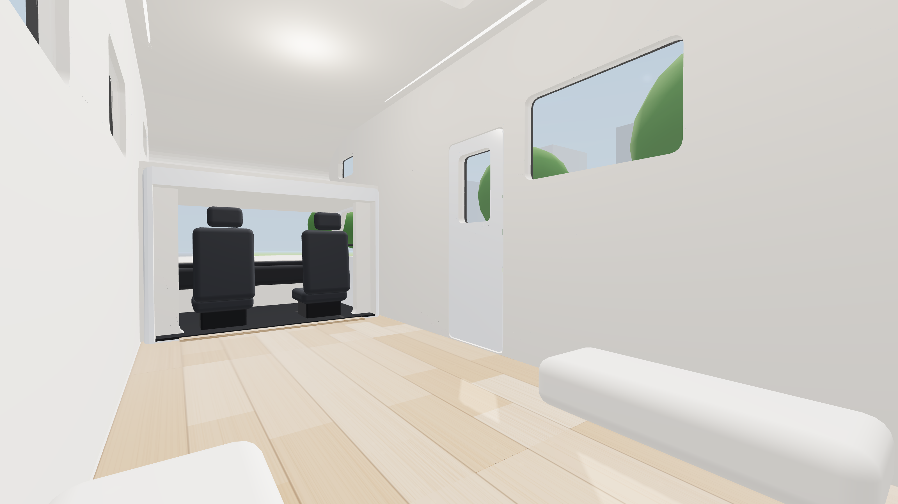
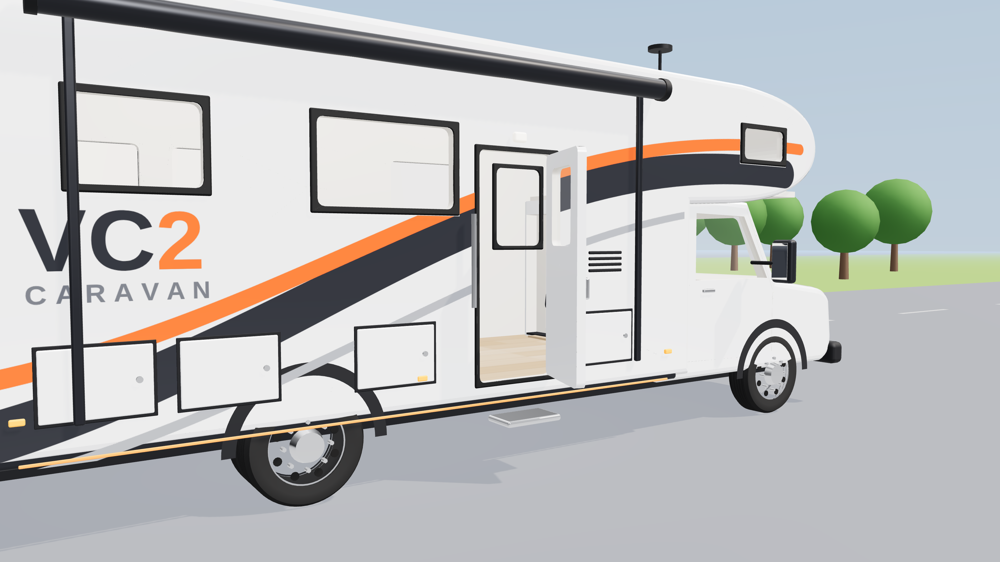
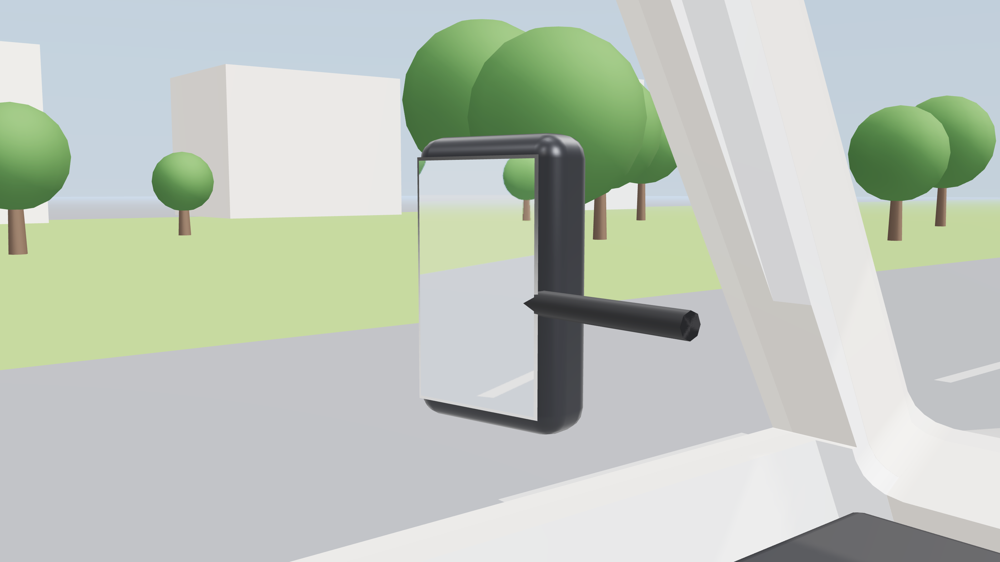
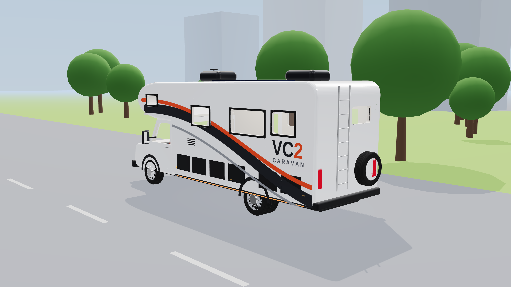
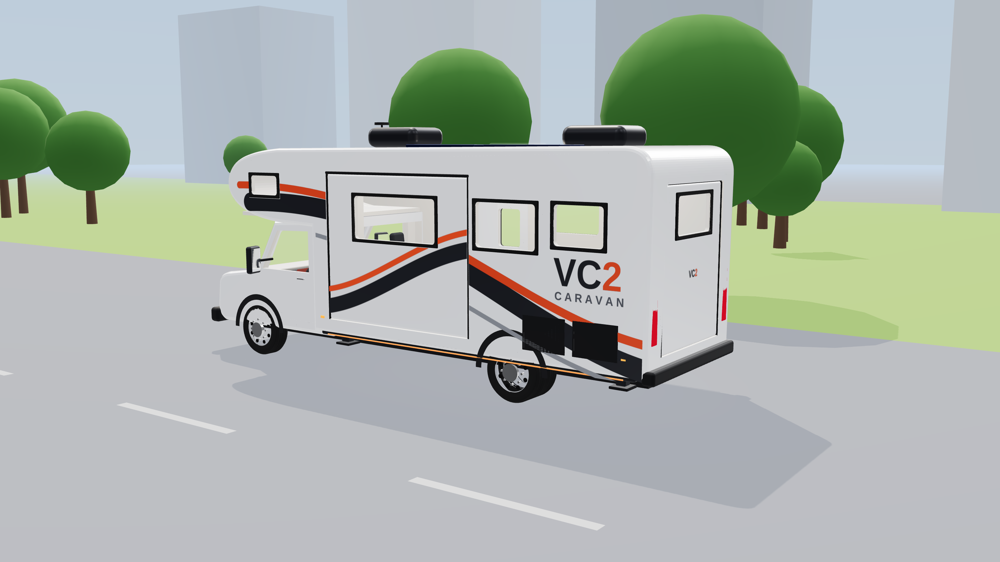
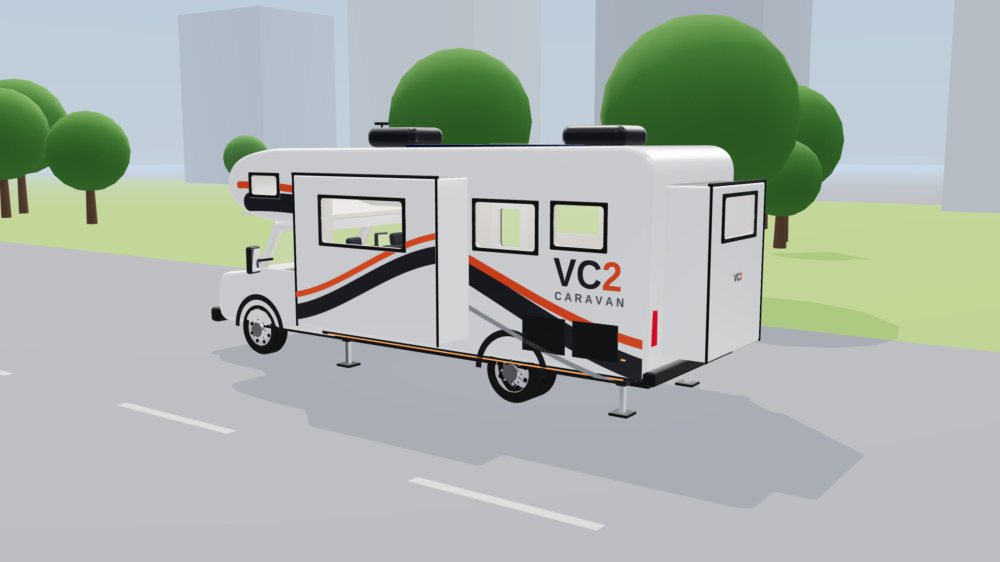
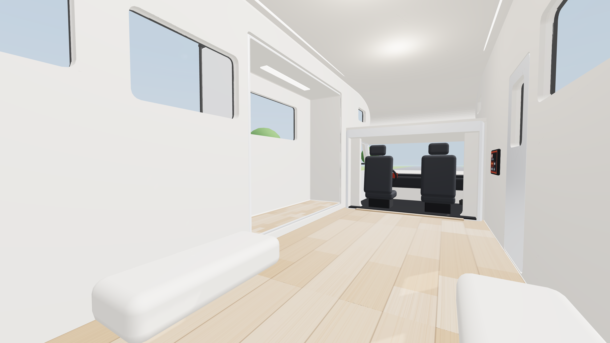
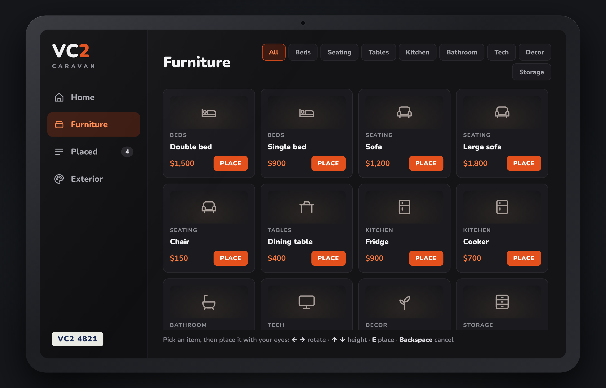
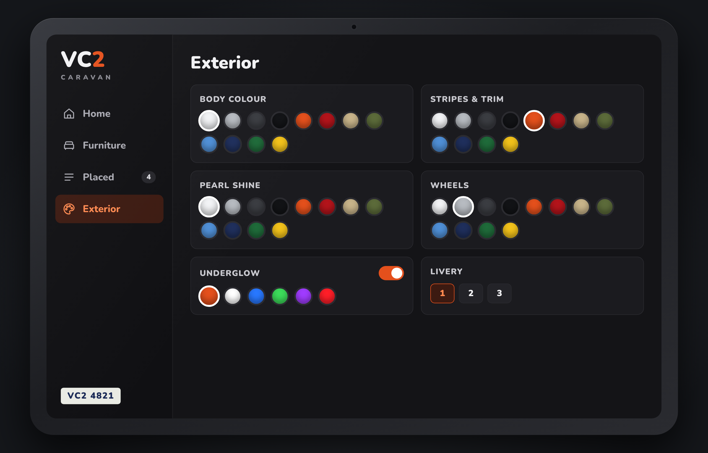

# Caravan VC2

An original, realistic Class C motorhome designed for VC2, built for FiveM. The interior is an **empty hollow shell** you can furnish yourself.

| | |
|---|---|
|  |  |
|  |  |

## What's in it
- **Hollow shell**: real wall thickness, floor, walls and ceiling. Real openings are cut through the walls: windows, entry door, skylight, rear window, and an open pass-through to the cab.
- **Empty living area**: vinyl plank floor, ceiling lights and LED strips, wheel wells over the rear wheels, and an empty cab-over bunk deck. Nothing else is inside, so you can furnish it.
- **Clear glass everywhere** (no tint): windshield, cab windows, all side windows, door window, skylight, rear window.
- **Mirrors**: two side mirrors with real mirror glass, angled toward the vehicle like real mirrors.
- **Opening doors**: both cab doors and the entry door are separate parts, each with its pivot on the hinge.
- **Cab**: dashboard and lit instrument cluster, a leather-wrapped steering wheel (stitching, aluminium spokes, VC2 airbag pad, buttons), two-tone leather captain seats (perforated pleated inserts, bolsters, armrests, headrest on chrome posts, swivel base), and a centre console with a leather-booted gear shifter, PRNDL indicator and cup holders.
- **Realistic wheels**: tyres with a sidewall profile and tread grooves, alloy front rims, steel/alloy **dual rear wheels**, hub caps and lug nuts.
- **Outside**: VC2 livery, awning, storage bays, roof AC units, solar panels, ladder, spare wheel, and lights: headlights, DRLs, fog, tail, marker and LED underglow.
- **Size**: ~8.1 m long, 2.45 m wide, ~3.75 m tall.

## Set-up mode, walk-in interior and customisation (FiveM script)

| Packed | Set up (Q) |
|---|---|
|  |  |

1. **Q while parked** (driver seat, standing still): the caravan sets up.
   - The 4 **stabiliser legs** come down to the ground and the body settles and locks in place.
   - The **side slide-out** pushes out (wider) and the **rear slide-out** pushes out (longer).
   - Press Q again to pack up in reverse. You can't drive while it is set up.
2. **Door**: look at the entry door with the **target eye** (ox_target / qb-target), or use E without a target script.
   - Open / close the door.
   - **Go inside** (optional teleport next to the door).
3. **Inside**: about 2.5 m of headroom, and the slide-outs add floor space with their own windows and lights.
4. **Wall screen** next to the door (target eye or E) opens the **VC2 Caravan Control** tablet:
   - **Home**: status, interior lights, step outside.
   - **Furniture**: beds, sofas, chairs, tables, kitchen, bathroom, TV, decor and storage.
     - Press **O** anywhere in or next to your caravan to open the furniture menu directly. Players can rebind it in *Settings > Key Bindings > FiveM*.
     - Placing: **aim** to move it · **arrow keys** fine move (hold Shift for faster) · **G** follow your aim again · **mouse wheel** rotate · **PgUp / PgDn** height · **Enter** place · **Backspace** cancel.
     - **Placed** list: **Move** (pick it up and place it again, free) or **Remove**.
     - Furniture is welded to the caravan: rigid attachment, no physics and no damage. Its collision turns off while the caravan drives, so it never shakes or glitches, and turns back on when it stops.
     - Items are paid for (QBCore / ESX), saved, and everyone sees them.
   - **Placed**: list of your furniture, with remove.
   - **Exterior**: body colour, stripes / trim, pearl, wheel colour, underglow (on/off + colour), livery.

| | |
|---|---|
|  |  |

- **Saving**: everything is stored per plate in the `vc2_caravans` table (created automatically, needs `oxmysql`).
- **Ownership** (`Config.Ownership`): with the VC2 script running, only the owner registered in VC2 (or `vc2.admin`) can set up, furnish and repaint. Anyone can do it without VC2.
- **Sync**: the set-up state and door are synced to everyone through the state bag `vc2rv`. Every client builds the slide-outs, legs and furniture for caravans near them.

### Extra props for the moving parts
Convert these the same way as the kiosk (static props, much easier than the vehicle). Put them in `fivem/vc2caravan/stream/` with a `vc2caravan_props.ytyp`, then uncomment the `data_file` line in `fxmanifest.lua`.

| Model file | Prop name |
|---|---|
| `model/vc2caravan_slideout_side.glb` | `vc2caravan_slideout_side` |
| `model/vc2caravan_slideout_rear.glb` | `vc2caravan_slideout_rear` |
| `model/vc2caravan_jack.glb` | `vc2caravan_jack` |

The vehicle model already has the openings for both slide-outs and the leg housings. Attach offsets are in `Config.Parts`.

## Folders
| Path | Contents |
|---|---|
| `model/vc2_caravan.glb` | The 3D model (glTF binary, ~80k triangles). Open in Blender / ZModeler. |
| `model/preview_*.png` | Renders: outside, inside, open door, mirror. |
| `model/vc2_caravan_builder.html` | Design source (three.js). Open in a browser. Views: `?v=front`, `side`, `rear`, `inside`, `inside_door`, `window`, `mirror`, `cabin`, `dooropen&door=open`, `deployed&deploy=1`, `deployed_in&deploy=1`. |
| `model/vc2caravan_slideout_*.glb`, `vc2caravan_jack.glb` | Moving parts (props) for set-up mode. |
| `fivem/vc2caravan/` | FiveM resource: vehicle meta (handling, vehicles, variations) + set-up mode, door, furniture and exterior script with the tablet UI. |

## Realistic driving (`fivem/vc2caravan/data/handling.meta`)
| | Value | Real-world reason |
|---|---|---|
| Weight | 6,000 kg | Typical Class C gross weight |
| Drive | Rear-wheel, 6-speed | Ford E-series style chassis |
| Top speed | ~115-120 km/h | Governed motorhome top speed |
| Acceleration | Slow (drive force 0.15) | 0-100 km/h in ~20 s |
| Brakes | Weak (0.28) | Long braking distance for a heavy vehicle |
| Centre of mass | High (+0.35 m) | Body leans in corners |
| Air drag | High (14) | Tall, flat front |
| Fuel tank | 150 L | |
| Sound | GTA `CAMPER` | |
| Glass | `diffuseTint 0x00FFFFFF` | No window tint |

These are starting values. Drive it in the game and tune it: top speed through `fInitialDriveMaxFlatVel`, weight through `fMass`, braking through `fBrakeForce`.

## Putting it in the game
GTA V needs the model in its own vehicle format: `vc2caravan.yft` + `vc2caravan_hi.yft` + `vc2caravan.ytd`. The `.glb` has to be rigged and exported once in **Blender + [Sollumz](https://github.com/Sollumz/Sollumz)** or in **ZModeler 3**.

1. Import `vc2_caravan.glb`.
2. **Rig it.** The parts already use GTA bone names, so they map straight onto the vehicle skeleton:
   - body: `bodyshell` / `chassis`
   - wheels: `wheel_lf`, `wheel_rf`, `wheel_lr`, `wheel_rr`
   - doors: `door_dside_f`, `door_pside_f`, and the entry door `door_pside_r`
   - glass: `windscreen`, `window_lf`, `window_rf`
   - cab: `steeringw`, `seat_dside_f`, `seat_pside_f`
   - lights: `headlight_l`, `headlight_r`, `taillight_l`, `taillight_r`, `indicator_lf`, `indicator_rf`
3. **Shaders:**
   - Glass: `vehicle_vehglass` with no tint.
   - Mirror glass (`vc2_mirror`): a chrome / reflective vehicle shader.
   - Body: `vehicle_paint` (so it can be repainted).
   - Lights: emissive vehicle light shaders.
4. **Collision**: add a simple collision (bounds) around the body and the cab. Leave the interior hollow so players can walk inside.
5. Export `vc2caravan.yft`, `vc2caravan_hi.yft` and `vc2caravan.ytd` into `fivem/vc2caravan/stream/`.
6. Copy `fivem/vc2caravan` to your server's `resources`, add `ensure vc2caravan` to `server.cfg`, and spawn it with `vc2caravan`.

## Notes
- **Mirrors**: GTA V does not render live mirror reflections on vehicles. In the game the mirror glass reflects the environment the way chrome does. The live reflections in `preview_mirror.png` only exist in the design preview.
- **Walking inside**: it works when the caravan is set up (frozen in place), as long as the vehicle collision you build is hollow. Until then, **Go inside** puts you inside next to the door. GTA has no built-in way to walk inside a moving vehicle.
- **Furniture props**: the catalogue uses GTA props. Any model missing on your server is hidden automatically. Add more in `Config.Furniture`.
- **Attach offsets**: `Config.Parts`, `EnterOffset`, the screen position and `InteriorBounds` match the model with its origin at the centre on the ground. After converting, check them in the game and adjust if your vehicle origin is different.
