# rox_police — ROX Store

> © **ROX Store** — جميع الحقوق محفوظة. صاحب الملفات: **ROX Store**. ممنوع إعادة البيع أو النشر بدون إذن.

سكربت شرطة كامل لـ FiveM: **iPad** فيه MDT + إدارة السجن + المخالفات + **Boss Menu**، وحجز السيارات بالعين الثالثة، ونزع الماسك.
يشتغل مع QBCore / Qbox / ESX، والبيانات تنحفظ في `data/db.json` (ما يحتاج قاعدة بيانات).

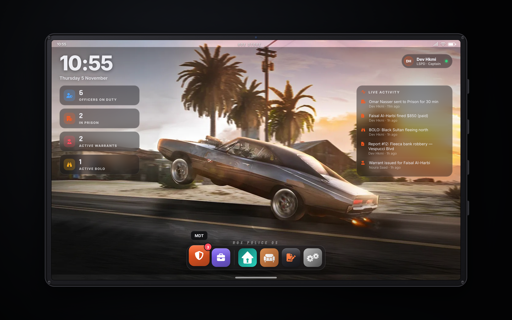
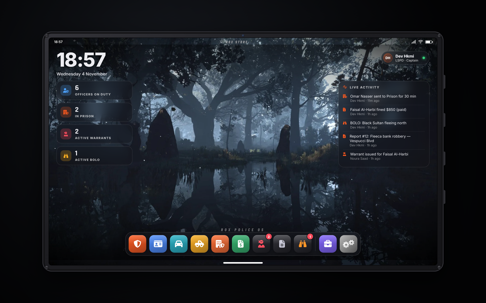

## طرق الفتح
| من وين | وش يفتح |
|---|---|
| **F1 › Police** | MDT، iPad، Prison، Citations، Impound، Unmask، Management (كابتن وفوق) |
| **iPad** (`/tablet` أو آيتم `tablet`) | الشاشة الرئيسية وفيها كل التطبيقات |
| **العين الثالثة على سيارة** (ox_target / qb-target) | Impound / Depot Vehicle |
| **العين الثالثة على لاعب** | Remove Mask / Hat |
| أوامر | `/mdt` `/jail` `/fine` `/impound` `/unmask` `/policeboss` `/tablet` `/paybail` |

لما تفتح الـ iPad، الشخصية تمسك تابلت بحركة حقيقية.

### ايباد واحد مع rox_realestate
إذا `rox_realestate` شغال، الـ Dock يطلع فيه **العقارات، الأثاث، العقود** — وايباد العقارات يطلع فيه تطبيقات الشرطة للشرطي. التنقل بينهم بدون ما يتسكر التابلت، والخلفية والحجم مشتركين.

### تصميم الـ iPad
- إطار iPad قوي (براغي، كاميرا، أزرار جانبية)، والشاشة الرئيسية فيها **خلفية** + ساعة + بطاقات زجاجية (الشرطة في الدوام، المساجين، أوامر القبض، BOLO) + **Live Activity**
- **تطبيقين بس للشرطة** في الـ Dock:
  - **MDT**: فيه كل شي للشرطة (المواطنين، السيارات، الحجز، أوامر القبض، التقارير، BOLO، السجن، المخالفات، حجز أقرب سيارة، نزع الماسك)
  - **Management**: للقادة (كابتن وفوق)
- وبعدها تطبيقات العقارات (إذا موجودة) والإعدادات
- داخل التطبيقات الخلفية تصير زجاج مغبش
- تطبيق **Settings**: تغيير الخلفية (3 خلفيات أو رابط https)، وحجم الـ iPad — ينحفظ لكل لاعب

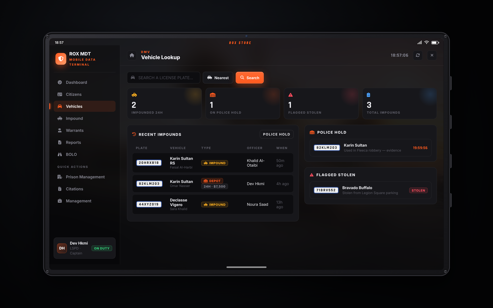
**Vehicles** في الـ MDT: كم سيارة انحجزت آخر 24 ساعة، اللي على حجز الشرطة، المبلغ عنها مسروقة، وآخر السيارات المحجوزة. وتبحث عن أي لوحة يطلع لك سجل الحجز كامل والوقت الباقي وزر الإفراج.

## 1. Management — Boss Menu (كابتن وفوق)
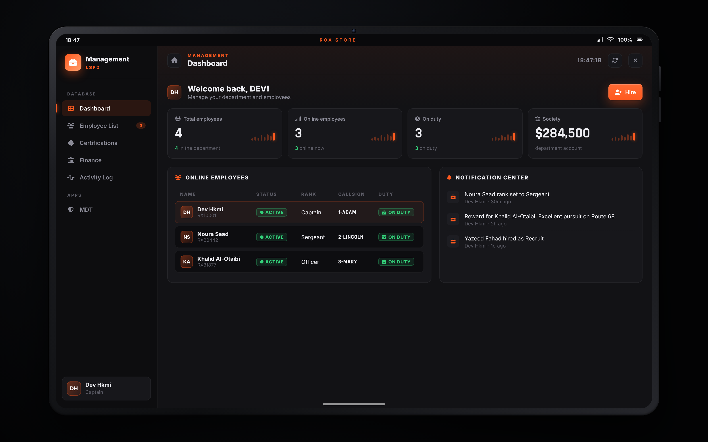
- **Dashboard**: عدد الموظفين، المتصلين، اللي في الدوام، رصيد الحساب، جدول المتصلين، والإشعارات
- **Employee List**: كل الموظفين (أونلاين وأوفلاين)، الرتبة، النداء (Callsign)، ساعات الدوام، المكافآت والإنذارات
- **Profile**: مكافأة / إنذار، **خريطة نشاط** لساعات الدوام لكل يوم وساعة، الشهادات، تغيير الرتبة، فصل، وملاحظات
- **Hire**: توظيف لاعب قريب منك برتبة تختارها
- **Certifications**: جدول الشهادات (Firearms، K9، SWAT، Air...)
- **Finance**: إيداع وسحب من حساب الشرطة (qb-banking / qb-management / Renewed-Banking / esx_society)
- **Activity Log**: كل شي سواه المدراء

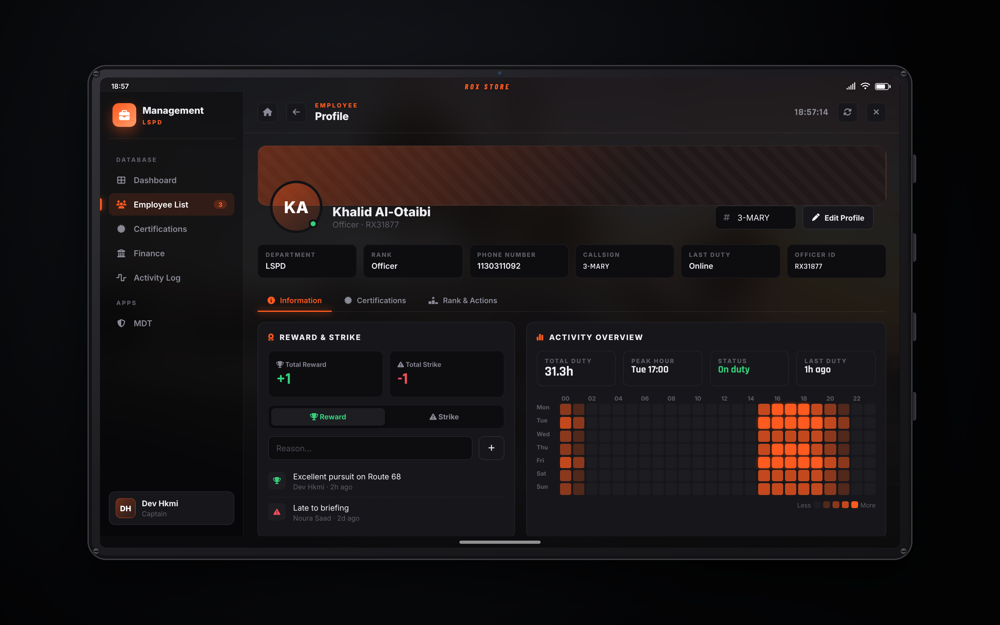

الحماية: ما تقدر تعطي رتبة أعلى أو تساوي رتبتك، ولا تغير رتبتك، ولا تفصل نفسك.
الرتبة المطلوبة: `Config.BossMinGrade` (ومن عنده `isboss` يدخل دايم).

## 2. Impound / Depot — حجز السيارات
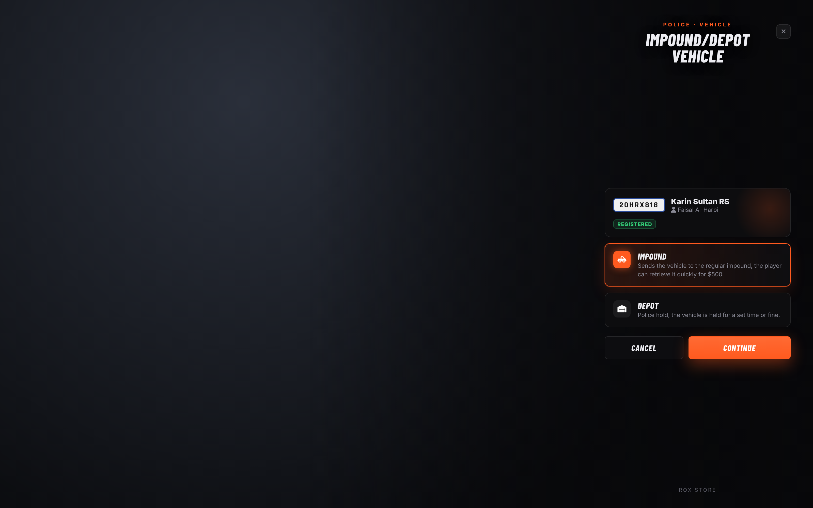 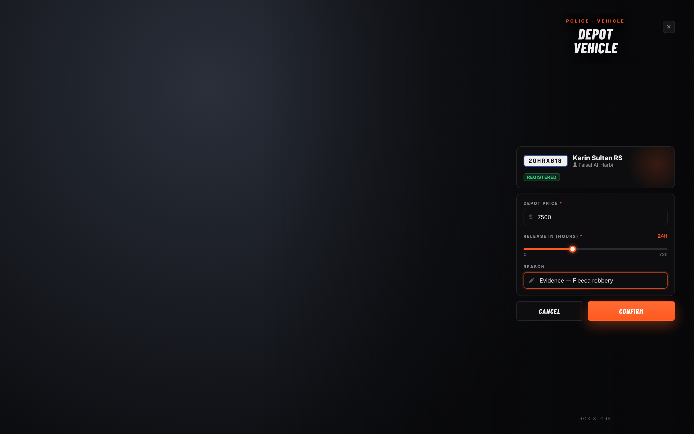
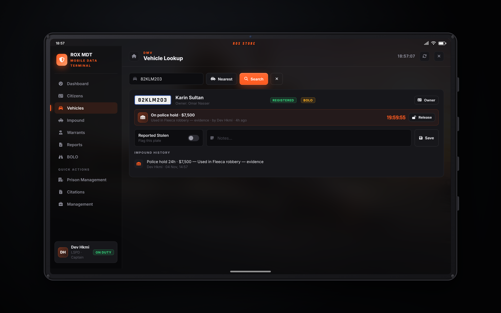
- **Impound**: تروح الحجز العادي، وصاحبها يطلعها بالسعر المحدد
- **Depot**: حجز شرطة، تحدد السعر ومدة الحجز بالساعات، والسبب
- الشرطي يكتب على لوح قبل الحجز، والسيارة تختفي
- السكربتات الثانية (القراج) تقدر تسأل: `exports.rox_police:IsVehicleHeld(plate)`
- صفحة **Vehicles** و **Impound** في الـ MDT فيها كل السيارات اللي حجزتها، سجل كل لوحة، الوقت الباقي، وزر الإفراج

## 3. Remove Accessories — نزع الماسك
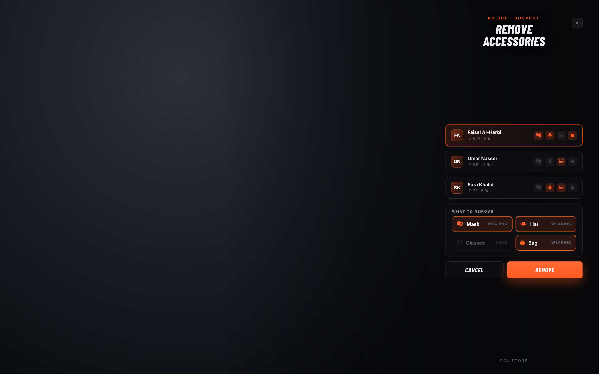
يطلع لك اللي حولك ووش لابسين (ماسك، كاب، نظارة، شنطة)، تختار وتنزعها.

## 4. Prison Management — إدارة السجن
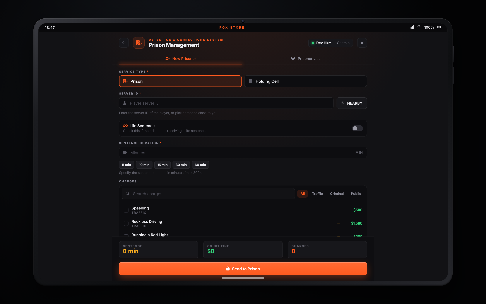
السجن أو الحجز، NEARBY، مؤبد، المدة تنحسب من التهم، كفالة (`/paybail`)، غرامة، قائمة المساجين، وسجن مدمج (نقل، منع هروب، عداد، إطلاق، الوقت محفوظ).

## 5. Citations — المخالفات
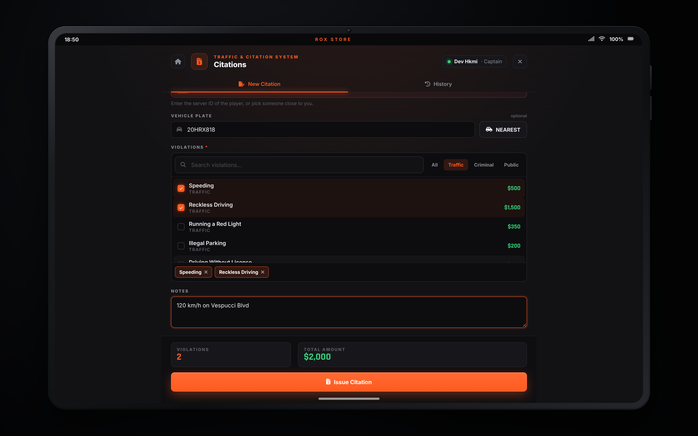

## 6. MDT
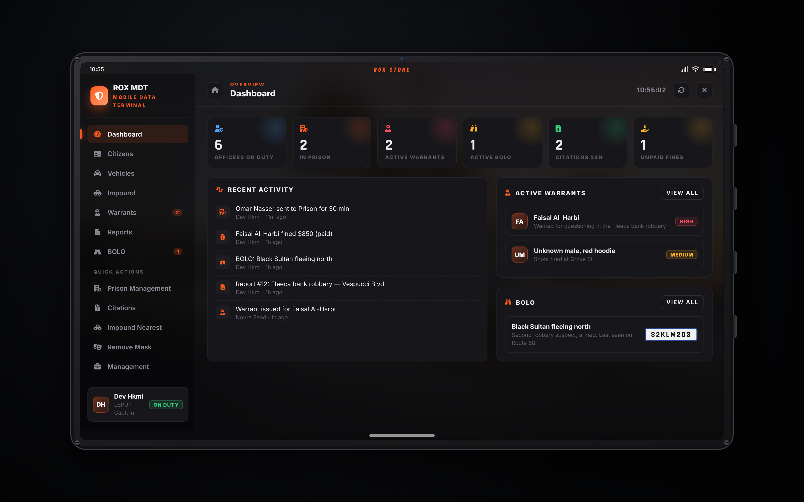
Dashboard، Citizens، Vehicles، **Impound**، Warrants، Reports، BOLO.

## التركيب
```
ensure rox_police
ensure rox_radialmenu
```
آيتم التابلت (اختياري) لـ QBCore في `qb-core/shared/items.lua`:
```lua
tablet = { name = 'tablet', label = 'Police iPad', weight = 500, type = 'item', image = 'tablet.png', unique = true, useable = true, shouldClose = true, description = 'Police iPad' },
```

## الإعدادات المهمة (`config.lua`)
`Config.PoliceJobs`، `Config.BossMinGrade`، `Config.Society`، `Config.Charges`، `Config.Jail.types`، `Config.Impound`، `Config.Accessories`، `Config.Certifications`، `Config.Tablet`

## الحماية
كل شي ينفحص في السيرفر: الوظيفة، الرتبة، المسافة، والمبالغ والمدد (ما ينفع أحد يغيرها من الواجهة).

## معاينة بالمتصفح
`html/index.html` (الـ iPad) — `?panel=boss` — `?panel=impound` — `?panel=strip` — `?panel=jail` — `?panel=mdt&hud=1`
