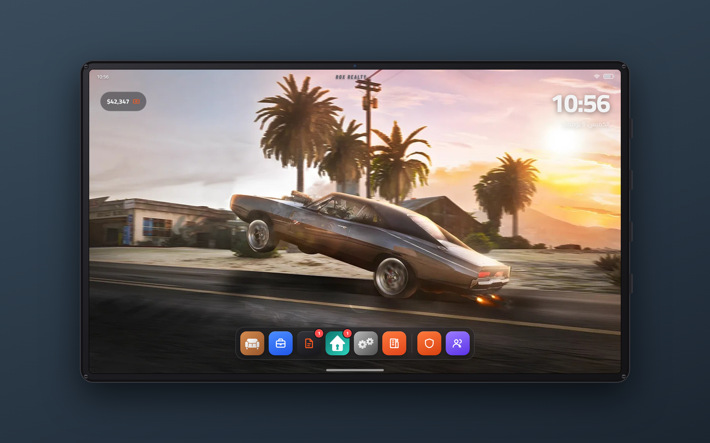

# ROX Real Estate — نظام عقاري كامل (FiveM)

**© ROX Store – جميع الحقوق محفوظة.** ممنوع إعادة البيع أو النشر بدون إذن متجر ROX.

نظام عقارات كامل مع **ايباد** فيه تطبيقات للمواطن وتطبيقات خاصة بالعقاري (حسب الوظيفة والرتبة).
يدعم **ESX / QBCore / Qbox** تلقائياً (أو standalone للتجربة)، ويحتاج **oxmysql** فقط.

## مين يشوف أي تطبيق
| التطبيق | يطلع لـ | الإعداد |
|---|---|---|
| **العقارات** (الخريطة، كل العقارات، المتاح، السوق) | العقاري بس حسب رتبته | `Config.Realtor.Apps.estate` (و `Config.Tablet.CitizenEstateApp = true` لو تبيه للكل) |
| **إنشاء عقار** / **إدارة العقارات** | العقاري حسب رتبته | `Config.Realtor.Apps.create` / `manage` |
| **الأثاث** | اللي عنده بيت (مالك أو مستأجر) | `Config.Tablet.FurnitureNeedsHome` |
| **العقود** | الكل (عقودك وتوقيعها) | — |
| **MDT** / **إدارة الشرطة** | الشرطة حسب الرتبة (من rox_police) | `Config.MdtMinGrade` / `Config.BossMinGrade` |

## ايباد واحد لكل تطبيقات ROX
إذا `rox_police` شغال، يطلع في نفس الايباد للي وظيفتهم شرطة تطبيق **MDT** (فيه كل شي للشرطة)، و**الإدارة** للقادة (كابتن وفوق).
وبالعكس: ايباد الشرطة فيه تطبيقات العقارات (العقارات، الأثاث، العقود).
- تنتقل بين التطبيقات والتابلت يبقى في يدك (نفس الـ prop).
- الخلفية وحجم الايباد مشتركة بين كل التطبيقات.



## المميزات

### ايباد العقاري (لازم الوظيفة + الرتبة)
- **إنشاء عقار** بخطوات:
  1. **التصميم**: تختار تصميم البيت من قائمة فيها صورة واسم كل تصميم (شقق، فلل، بنتهاوس...).
  2. **التفاصيل**: اسم العقار، نوع العقد (بيع / إيجار)، السعر، قيمة الإيجار وكل كم يوم، **ID المشتري**، ورابط صورة اختياري.
  3. **الموقع**: الايباد يقفل، **تصوّب على الباب** (أو أي مكان تبيه) وتضغط `E` للتأكيد (`Backspace` إلغاء).
  4. **التأكيد**: تشوف العقد كامل، تضغط **تأكيد وإرسال العقد** ← يطلع **العقد للمشتري** على شاشته يوقّعه أو يرفضه.
  - إذا ما كتبت ID مشتري، العقار ينعرض في قائمة **المتاح** والناس تقدر تشتريه/تستأجره من الايباد.
- **إدارة العقارات**: كل عقارات المدينة مع فلاتر وبحث، تعديل الاسم/السعر/الإيجار/التصميم/الصورة، تغيير موقع الباب بالتصويب، إرسال عقد لأي ID، وللرتب العالية: **إخلاء** و **حذف**.
- **العقود**: كل العقود (بانتظار التوقيع، موقّعة، مرفوضة، منتهية) مع إمكانية إلغاء العقد المعلّق.
- عمولة للعقاري من كل صفقة (`Config.Realtor.Commission`)، وإذا كان غير متصل توصله عند دخوله.

### ايباد المواطن
- **العقارات**: خريطة العقارات (دبابيس ملونة + تفاصيل عند المرور) + عقاراتي + المتاح + السوق.
- **صفحة العقار**: تحديد على الخريطة، قفل/فتح الباب، إعطاء وسحب المفاتيح، دفع الإيجار والمتأخرات، إنهاء الإيجار، عرض البيت للبيع في السوق.
- **الأثاث**: متجر أثاث بأقسام وبحث وسلة، تختار العقار وتطلب (الحد `Config.Furniture.MaxPieces`).
- **العقود**: عقودك، وتقدر تفتح العقد المعلّق وتوقّعه.

### داخل البيت
- كل بيت **Instance** خاص (routing bucket).
- عند المخرج اضغط `G` (يتغير من إعدادات اللعبة) يطلع **لوح الأثاث** يمين الشاشة:
  - **المخزن**: اضغط قطعة ← تصوّب مكانها وتضعها.
  - **تعديل الأثاث**: اضغط قطعة موضوعة ← تحركها، أو `Del` ترجعها للمخزن، أو تبيعها.
  - التحكم: `E/Enter` وضع · `عجلة الماوس / ← →` تدوير · `↑ ↓` ارتفاع · `Shift` دقيق · `G` تثبيت بالأرض · `Backspace` إلغاء.

### الإيجار
- يخصم تلقائياً إذا كان المستأجر متصل، وإلا ينحسب **متأخر** ويطلع له تنبيه.
- بعد `Config.Rent.MaxOverdue` دفعات متأخرة ← إخلاء تلقائي.

## التركيب
1. انسخ المجلد `rox_realestate` إلى `resources`.
2. في `server.cfg`:
   ```
   ensure oxmysql
   ensure es_extended   # أو qb-core
   ensure rox_realestate
   ```
   الجداول تنشأ تلقائياً (أو شغّل `sql/install.sql`).
3. عدّل `config.lua`:
   - `Config.Realtor.Jobs` = اسم وظيفة العقاري وأقل رتبة تفتح تطبيقات العقاري.
   - `Config.Realtor.ManageGrade` = الرتبة اللي تقدر تحذف وتخلي.
   - الأدمن يقدر يصير عقاري بـ: `add_ace group.admin rox_realestate.realtor allow`
4. فتح الايباد: الأمر `/ipad` أو زر `F6`، أو آيتم `realestate_ipad`:
   - **ESX**: أضف الآيتم لجدول `items` (`name = realestate_ipad`, `label = iPad`).
   - **QB**: في `qb-core/shared/items.lua`:
     ```lua
     realestate_ipad = { name = 'realestate_ipad', label = 'iPad', weight = 500, type = 'item', image = 'tablet.png', unique = true, useable = true, shouldClose = true, description = 'Real estate iPad' },
     ```

## الصور
- **صور البيوت**: حط الصور في `html/img/houses/` باسم مفتاح التصميم، مثلاً `wild_oats.jpg`، `penthouse_modern.jpg` (القائمة في `shared/interiors.lua`).
  أفضل طريقة: ادخل التصميم في اللعبة وخذ سكرين شوت. إذا الصورة مو موجودة يطلع تصميم بديل مرتب.
  تقدر بعد تحط رابط صورة (https) لكل عقار من خانة "رابط صورة".
- **الخريطة**: حط صورة خريطة GTA V باسم `html/img/map.jpg`. إذا استخدمت صورة بحدود مختلفة عدّل `Config.Map`.
- **صور الأثاث**: تنجاب تلقائياً من `Config.Furniture.ImageUrl` حسب اسم البروب، وإذا ما اشتغلت يطلع أيقونة القسم.

## إضافة تصاميم / أثاث
- تصميم جديد: أضفه في `shared/interiors.lua` (`spawn` = مكان الدخول/الخروج داخل البيت). تصاميم البنتهاوس تحتاج IPL (مثل bob74_ipl).
- أثاث جديد: أضفه في `shared/furniture.lua` (`model`, `label`, `cat`, `price`).

## اللغة
اللغة الأساسية **إنجليزي** (`Config.Locale = 'en'`) والبديلة **عربي**. كل لاعب يقدر يغيّر اللغة من تطبيق **الإعدادات** في الايباد، وتتغير معها الواجهة وتنبيهات السيرفر.

## الايباد (التصميم الجديد)
- الشاشة الرئيسية: خلفية كاملة + **Dock** تحت فيه التطبيقات: الأثاث · العقاري (إنشاء عقار) · العقود · العقارات · الإعدادات · إدارة العقارات.
  تطبيقات العقاري (إنشاء / إدارة) ما تطلع إلا لصاحب الوظيفة والرتبة.
- تطبيق **الإعدادات**: تغيير الخلفية (3 خلفيات + رابط صورة خاص)، **حجم الايباد** (70% – 115%)، واللغة. الإعدادات تنحفظ لكل لاعب.
- الأيقونات في `html/img/icons/` والخلفيات في `html/img/wallpapers/` — تقدر تستبدلها بنفس الأسماء.
- الخلفية الافتراضية: `Config.Tablet.DefaultWallpaper`.

## البيوت الجاهزة (Shells)
أضفت 15 تصميم من **k4mb1 Free Props & Starter Shells**
(https://forum.cfx.re/t/free-props-starter-shells-for-housing-scripts/4826922):
`container_shell`, `shell_trailer`, `shell_v16low`, `modernhotel_shell`, `shell_v16mid`, `furnitured_midapart`, `shell_trevor`,
`shell_lester`, `shell_frankaunt`, `shell_ranch`, `shell_michael`, `shell_garagemed`, `shell_office1`, `shell_store1`, `shell_warehouse1`.

1. حمّل ريسورس الشِلز من رابط المنتدى (يحتاج تسجيل دخول في cfx).
2. حطه في `resources` وشغّله **قبل** السكربت: `ensure k4mb1-shells` (أو اسم المجلد عندك).
3. التصاميم تطلع تلقائياً في خطوة "التصميم" وقت إنشاء عقار.

الشل ينرسم تحت باب البيت بـ `Config.ShellZOffset` (افتراضي -35)، وكل بيت Instance مستقل. إذا الشل مو موجود يطلع تنبيه وما يدخل اللاعب.

## ملاحظة للمطور
تقدر تفتح `html/index.html` في المتصفح مباشرة لمعاينة الواجهة ببيانات تجريبية:
`index.html?app=dashboard` · `?app=shop` · `?app=create&step=3` · `?app=manage` · `?contract=1` · `?fp=1` · `&lang=en`.

## v1.2

### صلاحيات تطبيقات العقاري حسب الرتبة
في `config.lua`:
```lua
Config.Realtor.Apps = { create = 0, manage = 1, contracts = 0 }
```
كل تطبيق ما يطلع في الـ Dock إلا إذا رتبتك **أكبر أو تساوي** الرقم، والسيرفر بعد يرفض العملية لو أحد حاول بدونها.
`Config.Tablet.CitizenAccess = false` ← الايباد كله للعقاريين فقط.

### نظام كشف البيوت (تلقائي)
- **الشلز**: حط ملفات البيت (`.ydr` + `.ytyp`) في `rox_realestate/stream/houses/` أو شغّل أي ريسورس شلز.
  السيرفر يفحص الملفات عند التشغيل (أي `.ydr` اسمه فيه `shell` وغيرها من `Config.Detect.NamePatterns`)، وكل لاعب يتأكد إن الموديل محمّل فعلاً،
  ويطلع البيت في "إنشاء عقار > التصميم" بعلامة **DETECTED**. اللي مو محمّل يطلع رمادي "غير محمّل".
- **الصور**: `html/img/houses/<اسم التصميم أو اسم الشل>.jpg|png|webp` تنعرف تلقائياً.
- **نقطة الدخول**: الشل المكتشف يدخلك تلقائياً لنص أرضيته. لتثبيت النقطة الصح: ادخل البيت كعقاري، وقف عند الباب من داخل واكتب
  `/houseentry اسم البيت` ← تنحفظ للأبد (جدول `rox_shells`) وتنطبق على كل البيوت اللي بنفس الشل.
- **إعادة الفحص** بدون رستارت: زر **Rescan** في التطبيق أو الأمر `/realestate_scan`.
- ملاحظة: فحص الملفات يستخدم `io.popen`. إذا السيرفر ما يسمح فيه، النظام يعتمد على قائمة الأسماء المعروفة + `Config.Detect.Extra`.

### MLO / ملفات map
اختر التصميم **Custom location / MLO**: تصوّب على الباب من برا، بعدها تدخل الـ MLO وتصوّب على الأرض اللي يطلع فيها اللاعب.
ملفات `.ymap` تقدر تحطها في `stream/houses/` وتنحمّل تلقائياً.

### الأثاث
- اضغط **O** في أي مكان داخل بيتك (مالك أو عندك مفتاح) يطلع لوح الأثاث.
- متجر الأثاث: أيقونات ملونة لكل قسم، والصور: `html/img/furniture/<model>.png` (تنعرف تلقائياً) ← بعدها رابط `Config.Furniture.ImageUrl` ← بعدها أيقونة القسم.
