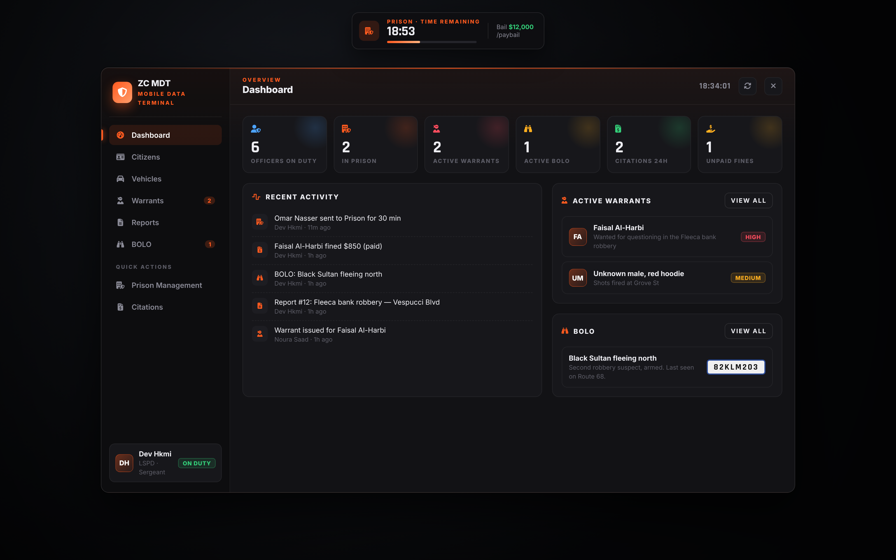
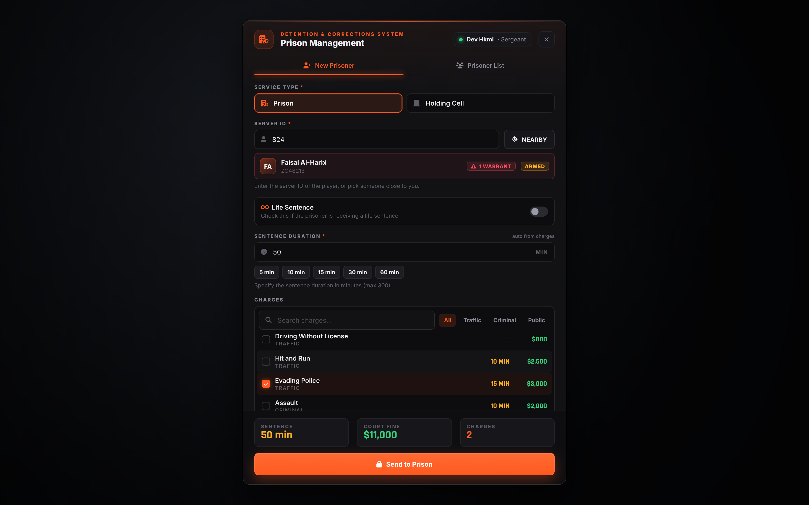
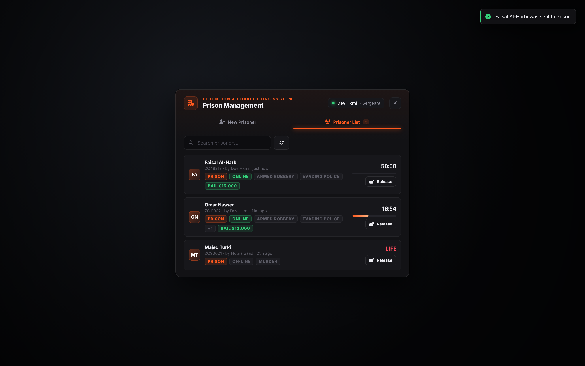
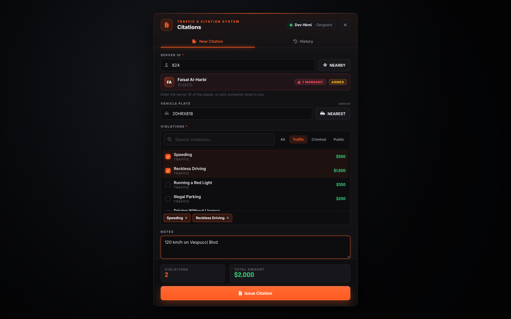
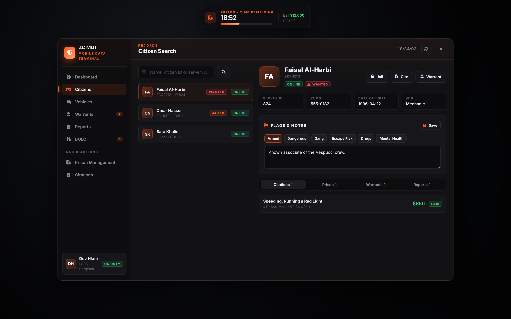

# zc_police — MDT + إدارة السجن + المخالفات

سكربت شرطة لـ FiveM بنفس ستايل `zc_radialmenu` (داكن + برتقالي). يشتغل مع QBCore / Qbox / ESX، وما يحتاج قاعدة بيانات (يحفظ في `data/db.json`).



## اللوحات
### 1. Prison Management — إدارة السجن

- نوع العقوبة: **Prison** أو **Holding Cell** (تضيف أنواع في الإعدادات)
- Server ID + زر **NEARBY** يطلع لك اللي حولك، ويبين اسمه، وإذا عليه أمر قبض أو Flags
- **Life Sentence**، مدة العقوبة (تنحسب تلقائي من التهم)، أزرار سريعة 5/10/15/30/60
- قائمة تهم جاهزة فيها بحث وأقسام، كل تهمة لها وقت وغرامة
- **Allow Bail** (كفالة) — السجين يدفعها بأمر `/paybail`
- **Charge Court Fine** يسحب غرامة التهم من البنك
- تبويب **Prisoner List**: الوقت الباقي يعد، كفالة، أونلاين/أوفلاين، وزر **Release**



**السجن المدمج:** ينقل السجين، يسحب سلاحه، يرجعه لو حاول يطلع، عداد فوق الشاشة، ويطلعه لما تخلص المدة. الوقت محفوظ حتى لو طلع من السيرفر ورجع.

### 2. Citations — المخالفات

- Server ID + NEARBY، لوحة السيارة + زر **NEAREST**
- قائمة مخالفات (مرور / جنائي / عام) والمجموع ينحسب تلقائي
- تنسحب من البنك، وإذا ما عنده فلوس تنحفظ **غير مدفوعة**
- تبويب **History** + زر Mark paid

### 3. MDT
| الصفحة | وش فيها |
|---|---|
| Dashboard | الشرطة المتواجدين، المساجين، أوامر القبض، BOLO، مخالفات اليوم، غير المدفوعة + آخر الأحداث |
| Citizens | بحث بالاسم / Citizen ID / Server ID، ملف كامل: بيانات، Flags (مسلح، خطير، عصابة...)، ملاحظات، مخالفات، سوابق سجن، أوامر قبض، تقارير + أزرار Jail / Cite / Warrant |
| Vehicles | بحث لوحة (يقرأ المالك من قاعدة بيانات QB/ESX لو oxmysql موجود)، Stolen، ملاحظات، BOLO |
| Warrants | إصدار أمر قبض بمستوى خطورة، وإغلاقه |
| Reports | تقارير الحوادث |
| BOLO | تعميم ينرسل لكل الشرطة |



## التركيب
```
ensure zc_police
ensure zc_radialmenu
```
من **F1 › Police** تلقى: **MDT** و **Prison** و **Citations**. أو الأوامر: `/mdt`، `/jail [id]`، `/fine [id]`.

## الإعدادات (`config.lua`)
- `Config.PoliceJobs` الوظائف المسموحة
- `Config.Charges` التهم والمخالفات `{ cat, label, fine, time }`
- `Config.Jail.types` أماكن السجن (داخل / نصف القطر / مكان الخروج)
- `Config.Jail.builtIn = false` + `Config.OnJail` لو تبي تستخدم سكربت سجن ثاني
- `Config.MaxActionDistance` لازم الشرطي يكون قريب (حماية)

## الحماية
كل شي ينفحص في السيرفر: الوظيفة، المسافة، والغرامة تنحسب من الإعدادات في السيرفر (ما ينفع أحد يغير المبلغ من الواجهة).

## معاينة بالمتصفح
`html/index.html?panel=mdt` — `?panel=jail` — `?panel=fine&id=824` — `&hud=1` يطلع عداد السجن.
