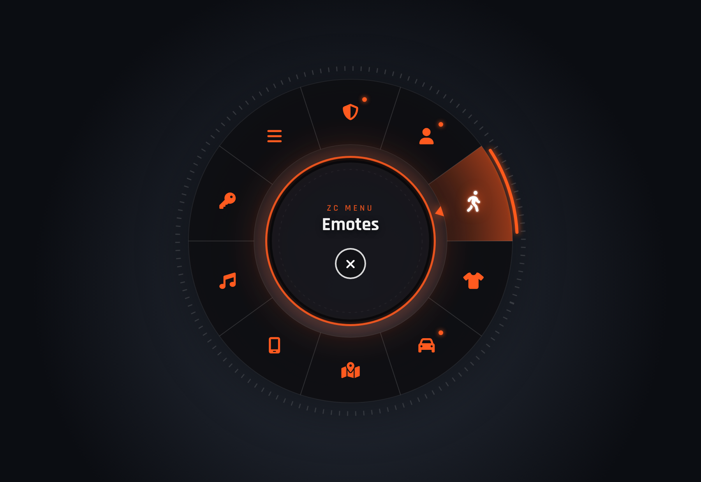
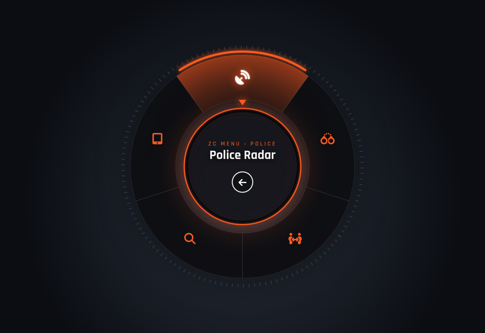

# zc_radialmenu — قائمة F1 دائرية

قائمة دائرية (Radial Menu) لـ FiveM بتصميم داكن زجاجي مع لون برتقالي متوهج، مستوحاة من شكل قوائم السيرفرات الحديثة.




## المميزات
- تفتح بزر **F1** (يقدر اللاعب يغيره من إعدادات GTA > Key Bindings > FiveM)
- اختيار بالماوس من أي مكان في الشاشة حسب الاتجاه، مع مؤشر يدور على الحلقة
- قوائم فرعية بلا حد + مسار (ZC MENU › Police) وزر رجوع في النص
- قوائم خاصة بالوظيفة (police / ambulance ...) — يتعرف تلقائياً على QBCore / Qbox / ESX، ويشتغل بدونهم
- `canInteract` لإخفاء عناصر حسب الحالة (مثلاً قائمة السيارة تظهر بس وأنت داخلها)
- أوامر سيارة جاهزة: مكينة، كبوت، شنطة، أبواب، دريشات، تبديل مقعد، قلب السيارة
- `Config.KeepInput` يخلّيك تمشي/تسوق والقائمة مفتوحة
- Font Awesome مضمّن داخل السكربت (ما يحتاج إنترنت)

## التركيب
1. انسخ مجلد `zc_radialmenu` إلى `resources`
2. أضف في `server.cfg`:
   ```
   ensure zc_radialmenu
   ```

## الإعدادات (`config.lua`)
```lua
Config.Color = '#ff5a1f'   -- لون القائمة
Config.Title = 'ZC MENU'   -- العنوان في النص

{ label = 'GPS', icon = 'map-location-dot', type = 'command', command = 'gps' }
{ label = 'Cuff', icon = 'handcuffs', type = 'client', event = 'police:client:CuffPlayer' }
{ label = 'Bill', icon = 'receipt', type = 'server', event = 'myjob:server:bill', args = { amount = 500 } }
```
أسماء الأيقونات من https://fontawesome.com/search?o=r&m=free&s=solid

## التحكم
| الزر | الوظيفة |
|---|---|
| F1 | فتح / إغلاق |
| كليك يسار | اختيار |
| كليك يمين / Backspace | رجوع |
| ESC | إغلاق |

## معاينة بالمتصفح
افتح `html/index.html` في المتصفح مباشرة يطلع لك عرض تجريبي.

## Exports
```lua
exports.zc_radialmenu:IsOpen()
exports.zc_radialmenu:Close()
```
