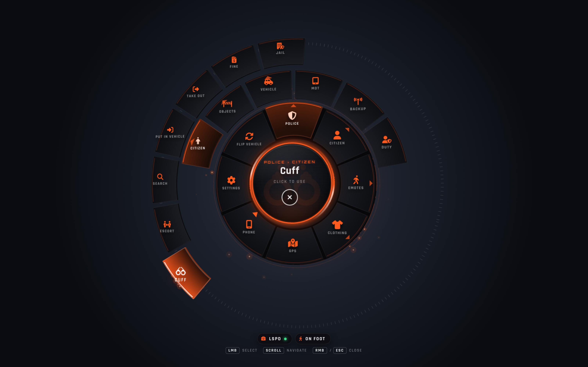
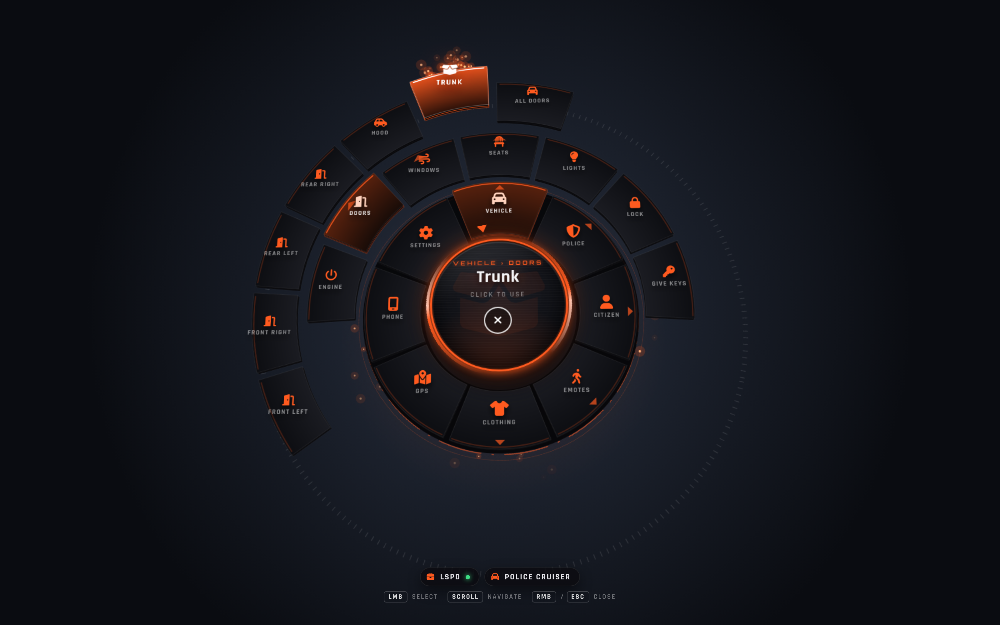
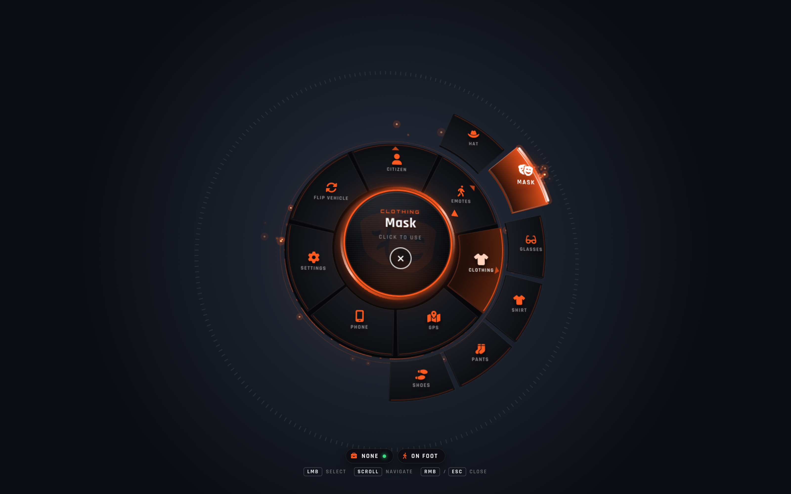

# zc_radialmenu — قائمة F1 ذكية (5D)

قائمة دائرية لـ FiveM على زر **F1** وحده، تتغير حسب حالتك:
- **الشرطة** تطلع بس إذا وظيفتك شرطة
- **السيارة** تطلع بس إذا ركبت سيارة
- **الإسعاف** تطلع بس للإسعاف





## طريقة الاستخدام
أشّر على قسم، تنفتح خياراته **حلقة ثانية حوله** (ولو فيه قسم داخلي تنفتح حلقة ثالثة). اضغط على الخيار وخلاص.

| الزر | الوظيفة |
|---|---|
| F1 | فتح / إغلاق |
| كليك يسار / Enter | اختيار |
| عجلة الماوس | تنقل |
| كليك يمين / ESC | إغلاق |
| Backspace | رجوع حلقة |

## التصميم
- 3D حقيقي: القائمة تميل مع الماوس، القطع مجسّمة وترتفع لما تأشر عليها، والحلقات الخارجية أعلى من الداخلية
- الحلقة الخارجية تنفتح بحركة حول القسم اللي اخترته، والمسار يتلوّن (Police › Citizen › Cuff)
- دائرة نص زجاجية بإطار يلف، أيقونة كبيرة شفافة للخيار، وخط مسح
- تحت القائمة: وظيفتك وحالة الدوام، واسم سيارتك أو "On Foot"
- جزيئات متوهجة وأصوات خفيفة
- مخفف للأداء (FiveM NUI)

## التركيب
1. انسخ مجلد `zc_radialmenu` إلى `resources`
2. أضف في `server.cfg`:
   ```
   ensure zc_radialmenu
   ```

## الإعدادات (`config.lua`)
```lua
Config.Key   = 'F1'
Config.Color = '#ff5a1f'
Config.Title = 'ZC MENU'
Config.Sound = true

Config.Menu = {
    { label = 'Vehicle', icon = 'car', vehicle = true, items = { ... } },          -- بس داخل سيارة
    { label = 'Police', icon = 'shield-halved', jobs = { 'police' }, items = { ... } }, -- بس للشرطة
    { label = 'Flip Vehicle', icon = 'rotate', vehicle = false, ... },             -- بس وأنت ماشي
    { label = 'GPS', icon = 'map-location-dot', type = 'command', command = 'gps' },
}
```

| الحقل | معناه |
|---|---|
| `jobs = { 'police' }` | يطلع بس لهذي الوظائف |
| `vehicle = true / false` | داخل سيارة / ماشي |
| `duty = true` | بس وأنت في الدوام |
| `canInteract = function() ... end` | أي شرط تبيه |
| `type` | `'client'` / `'server'` / `'command'` |
| `items = { ... }` | يخليه قسم وتنفتح له حلقة |
| `keepOpen = true` | ما تتسكر القائمة بعد الاختيار |

الشروط تشتغل على أي مستوى (قسم أو خيار داخلي). يتعرف تلقائياً على QBCore / Qbox / ESX.
أسماء الأيقونات: https://fontawesome.com/search?o=r&m=free&s=solid

## معاينة بالمتصفح
افتح `html/index.html`:
- `index.html?job=police&veh=1` شرطي داخل سيارة
- `index.html?job=police&veh=0` شرطي ماشي
- `index.html?job=none&veh=0` مواطن

## Exports
```lua
exports.zc_radialmenu:Open()
exports.zc_radialmenu:Close()
exports.zc_radialmenu:IsOpen()
```
